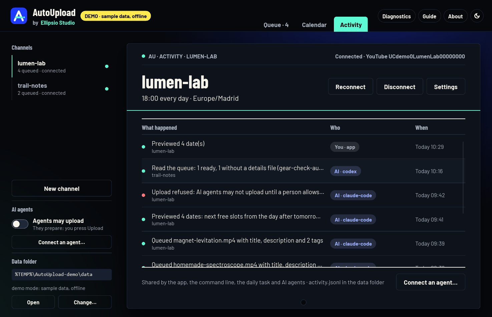

<p align="center"></p>

<h1 align="center">AutoUpload</h1>

<p align="center"><b>Automatiza tus subidas a YouTube desde tu propia computadora.</b><br>
Una aplicación nativa y línea de comandos escritas en Rust, que los agentes de IA pueden manejar. Sin servidor, sin cuenta, con tu propia cuota.</p>

<p align="center">
<a href="https://github.com/DaoSource111/autoupload/releases/latest"></a>


<a href="LICENSE"></a>
</p>

<p align="center"><a href="README.md">English</a> · <b>Español</b> · <a href="https://daosource111.github.io/autoupload/es/">Sitio web</a> · <a href="https://daosource111.github.io/autoupload/es/install.html">Guía de instalación</a> · <a href="https://daosource111.github.io/autoupload/es/agents.html">Agentes IA</a></p>

<p align="center"></p>

> **Sobre las capturas:** todas las capturas de este repositorio y de la web se tomaron en modo demo. Los canales, videos, títulos, fechas y la actividad que aparecen son datos de prueba; no pertenecen a ningún canal ni cuenta real de YouTube.

Pon los videos terminados en la carpeta de cola de un canal, cada uno con un pequeño archivo YAML que contiene su título
y sus datos. AutoUpload los sube como videos **privados** y asigna a cada uno el **siguiente horario libre** del canal,
para que YouTube los publique a su hora. O dile a un agente de IA «pon en cola todo lo de mi carpeta de exportaciones
con buenos títulos y etiquetas», y mira en la app lo que hizo.

## Por qué AutoUpload

| | |
|---|---|
| **Nativa, escrita en Rust** | Un programa pequeño por sistema (la línea de comandos pesa unos 9 MB, la aplicación de escritorio unos 24 MB). Sin Python, sin Node, sin Electron ni motor de navegador dentro, y nada más que instalar: descarga, descomprime, ejecuta. |
| **Primero en local** | No hay servidor ni cuenta de AutoUpload. Tus videos, tu inicio de sesión y tu historial se quedan en tu computadora y solo hablan con Google, a través de *tu propio* cliente OAuth y tu propia cuota. |
| **Hecha para agentes de IA** | `autoupload mcp` es un servidor [Model Context Protocol](https://modelcontextprotocol.io): Claude Code, Codex, Cursor y otros agentes reciben herramientas tipadas para poner videos en cola, escribir sus datos y previsualizar fechas. Subir necesita tu permiso, y todo lo que haga un agente aparece en la app. |
| **Segura por defecto** | Nada se sube sin confirmación (`--yes` o el botón Upload). Nada se hace público de inmediato salvo que lo permitas, y nunca lo decide un agente. Se niega a subir si la cuenta con la que iniciaste sesión no es la del canal. Nunca se sube dos veces el mismo archivo. |
| **Pensada para ejecuciones sin supervisión** | Las subidas se reanudan tras un fallo o un reinicio desde el último byte que recibió Google. Los límites cortos se reintentan; una cuota diaria agotada se detiene limpiamente. Una tarea diaria (Programador de tareas, launchd o systemd) vacía todas las colas mientras duermes. |

## Pruébala en diez segundos, sin Google

```powershell
autoupload-gui --demo        # la aplicación de escritorio con canales de ejemplo y un YouTube sin conexión
autoupload --demo queue lumen-lab
```

El modo demo usa su propia carpeta en el directorio temporal y nunca contacta a Google, así que puedes pulsar todos los
botones (Upload incluido) sin riesgo. Las capturas de esta página se tomaron con él.

## Descarga

Descarga el archivo de tu sistema desde la [última versión](https://github.com/DaoSource111/autoupload/releases/latest).
Cada uno incluye la aplicación de escritorio (`autoupload-gui`) y la línea de comandos (`autoupload`):

| Sistema | Archivo | Primer inicio |
|---|---|---|
| Windows 10/11 (x64) | `AutoUpload-<version>-windows-x64.zip` | descomprime y abre `autoupload-gui.exe`; si SmartScreen avisa, elige *Más información → Ejecutar de todas formas* |
| macOS 11+ (Apple silicon) | `AutoUpload-<version>-macos-arm64.zip` | mueve `AutoUpload.app` a Aplicaciones y, la primera vez, haz clic derecho → *Abrir* |
| macOS 11+ (Intel) | `AutoUpload-<version>-macos-x64.zip` | igual que arriba |
| Linux (x64, glibc 2.35+) | `AutoUpload-<version>-linux-x64.tar.gz` | descomprime y ejecuta `./install.sh` (lo añade al menú de aplicaciones) o `./autoupload-gui` |

Las compilaciones aún no están firmadas digitalmente, de ahí los avisos. Verifica una descarga con `SHA256SUMS` o con
`gh attestation verify <archivo> --repo DaoSource111/autoupload`.

## Antes de la primera subida

Cada usuario crea su propio cliente OAuth de tipo **App de escritorio** en Google Cloud, habilita la YouTube Data API v3
y guarda el archivo del cliente como `config/client_secret.json` dentro de la carpeta de datos. La
[guía de instalación](https://daosource111.github.io/autoupload/es/install.html) lo explica paso a paso (o se la entregas
a un agente de IA). El botón **Diagnostics** de la app, o `autoupload doctor`, indica exactamente qué falta.

AutoUpload pide a Google solo tres permisos: `youtube.upload`, `youtube.force-ssl` y `youtube.readonly`; el
[sitio web](https://daosource111.github.io/autoupload/es/#permissions) explica para qué sirve cada uno.

## Aplicación de escritorio

<p align="center"> </p>

Crea un canal, pulsa **Connect** para iniciar sesión con Google, pon los videos en la carpeta de cola del canal y pulsa
**Preview dates**. **Upload** pide confirmación y luego muestra el progreso en vivo. **Calendar** lista lo que ya está
publicado y programado en YouTube. **Activity** muestra lo que hicieron tú, la tarea diaria y los agentes de IA. La vista
clara y la vista noche siguen el aspecto de la web; el botón de sol y luna las cambia.

## Automatízala con un agente de IA

<p align="center"></p>

Registra AutoUpload una vez en tu agente (el botón **Connect an agent…** de la app muestra estas líneas con la ruta
correcta para tu computadora):

```powershell
claude mcp add autoupload -- autoupload mcp                  # Claude Code
```

```toml
# CLI de Codex: ~/.codex/config.toml
[mcp_servers.autoupload]
command = "autoupload"
args = ["mcp"]
```

Cualquier otro cliente MCP: un servidor stdio con el comando `autoupload` y el argumento `mcp`. Luego pide en lenguaje
natural, por ejemplo *«Pon en cola todos los videos de D:\Exports para lumen-lab con un título, una descripción y
etiquetas, y luego muestra las fechas.»*

| Herramienta | Qué hace | Requiere tu permiso |
|---|---|---|
| `status` | carpeta de datos, canales, inicio de sesión, tamaño de las colas, lo que los agentes pueden hacer | |
| `list_queue` | los videos de una cola y lo que bloquea a cada uno | |
| `add_video` | copia (o mueve) un video a una cola y escribe su archivo de datos | |
| `write_sheet` | escribe o reemplaza los datos de un video en cola | |
| `plan` | la fecha que recibiría cada video en cola; no sube nada | |
| `upload` | sube la cola como videos privados programados | sí: **Agents may upload** en la app, o `autoupload agents allow-upload on` |
| `calendar` | subidas publicadas y programadas de un canal | |
| `doctor`, `activity` | revisiones de configuración; acciones recientes | |

Los agentes nunca pueden publicar un video como público de inmediato. Cada llamada se escribe en `activity.jsonl` de la
carpeta de datos, con el nombre del agente, y la pestaña Activity de la app la recoge en menos de dos segundos. Un agente
sin MCP puede usar la terminal: define `AUTOUPLOAD_AGENT=<su nombre>` y añade `--json` a cualquier comando; se aplican
las mismas reglas. La guía completa, con ejemplos de peticiones, está en
https://daosource111.github.io/autoupload/es/agents.html y en [AGENTS.md](AGENTS.md).

## Línea de comandos

```powershell
autoupload doctor                              # revisa la configuración y muestra la carpeta de datos
autoupload channel new mychannel               # crea un canal
autoupload auth mychannel login                # inicia sesión con Google (whoami, logout)
autoupload add mychannel clip.mp4 --title "My video" --tags a,b   # pone un video en cola con sus datos
autoupload queue mychannel                     # qué está en cola y qué lo bloquea
autoupload schedule mychannel                  # muestra las fechas: no sube nada
autoupload schedule mychannel --yes            # sube
autoupload calendar mychannel                  # videos publicados y programados
autoupload activity                            # quién hizo qué, lo más reciente al final
autoupload task install --time 10:00           # sube cada cola a diario (task remove, task status)
autoupload agents setup                        # conecta un agente de IA
autoupload data-folder D:\Videos\AutoUpload    # guarda canales y configuración en otro lugar
```

`--json` imprime una salida que un programa puede leer; `--demo` funciona con todos los comandos. Códigos de salida:
`0` correcto, `2` entrada o configuración no válida, `3` autenticación, `4` error de YouTube.

## Ejecución diaria

`autoupload task install --time 10:00` registra una ejecución diaria con el programador del sistema: Programador de
tareas en Windows, launchd en macOS, un temporizador de usuario de systemd en Linux (con una línea de `crontab` como
alternativa). Ejecuta `autoupload task run`, que sube la cola de cada canal, escribe un registro en `logs/` dentro de la
carpeta de datos (se conserva 60 días) y anota el resultado en la pestaña Activity. `autoupload task remove` la elimina.

## Configuración del canal (`channels/<channel>/channel.yaml`)

| Clave | Por defecto | Significado |
|---|---|---|
| `profile` | nombre del canal | nombre del token OAuth |
| `client_secret` | `../../config/client_secret.json` | archivo del cliente OAuth de escritorio |
| `timezone` | `"+00:00"` | zona horaria de `hours`: un nombre que sigue el horario de verano (`Europe/Madrid`, `America/Lima`) o un desfase fijo respecto a UTC (`+00:00`, `-05:00`) |
| `hours` | `["08:00"]` | horas de publicación de cada día |
| `days_between` | `1` | 1 = cada día, 7 = una vez por semana |
| `min_lead_hours` | `3` | nunca programar más cerca de ahora que esto |
| `max_per_run` | `5` | subidas por ejecución |
| `language` | `en` | idioma del título, la descripción y el audio |
| `category` | `"27"` | ID de categoría de YouTube (27 Educación, 28 Ciencia y tecnología, 24 Entretenimiento) |
| `made_for_kids` | `false` | declaración de «hecho para niños» |
| `contains_ai` | `null` | declaración de contenido alterado o sintético |
| `notify_subscribers` | `false` | avisar a los suscriptores al publicar |
| `playlist` | `null` | ID de lista de reproducción para cada subida |
| `base_tags` | `[]` | etiquetas que se añaden a todos los videos |
| `description_footer` | `""` | texto que se añade al final de cada descripción |

Las claves desconocidas se rechazan, así que una errata se avisa en lugar de ignorarse en silencio.

## Ficha del video (`<video>.yaml` junto a cada video)

```yaml
title: Why is the sky blue? A 5-minute experiment     # la única clave obligatoria
description: |
  Rayleigh scattering with a glass of water and a torch.
tags: [physics, light, experiment]
publish_at: 2026-12-01T18:00:00+01:00   # fecha fija opcional; si no, el siguiente horario libre
```

Otras claves: `thumbnail` (o una imagen con el mismo nombre junto al video), `playlist_id`, `privacy`, `category_id`,
`default_language`, `default_audio_language`, `made_for_kids`, `contains_synthetic_media`, `notify_subscribers`,
`captions`, `localizations`.

## Dónde están tus datos

- **Carpeta de datos** (`channels/`, `config/`, `activity.jsonl`, `logs/`), elegida en este orden: `AUTOUPLOAD_HOME`; la
  carpeta que fijes con `autoupload data-folder` o con el botón **Change…** de la app; una carpeta `channels/` o `config/`
  junto al programa (copia portátil); si no, `Documentos\AutoUpload` (`~/AutoUpload` en macOS y Linux).
- **Tokens de inicio de sesión y configuración**: `%APPDATA%\AutoUpload` en Windows, `~/.config/autoupload` en macOS y
  Linux (se cambia con `AUTOUPLOAD_CONFIG_DIR`); en macOS y Linux, solo tu usuario puede leer esos archivos.
- `config/client_secret.json`, los tokens y los datos de los canales nunca deben compartirse ni subirse a un repositorio;
  `.gitignore` los excluye.
- Los archivos de AutoUpload 1.x (tokens, `channel.yaml`, archivos de video, `state.sqlite`) se leen sin cambios.

## Compilar desde el código

Requiere Rust 1.95 o posterior (en Linux también `libfontconfig1-dev libxkbcommon-dev`):

```powershell
cargo test --workspace
cargo build --release          # target/release/autoupload y autoupload-gui
cargo run -p autoupload-gui -- --demo
```

## Estructura del repositorio

| Ruta | Contenido |
|---|---|
| `crates/core/` | el motor: canales, cola, OAuth, cliente y subida reanudable de YouTube, estado, registro de actividad, operaciones de agentes, tarea diaria y demo |
| `crates/cli/` | la línea de comandos `autoupload` y su servidor MCP (`src/mcp.rs`) |
| `crates/gui/` | la aplicación de escritorio (Slint, con las fuentes y colores de la web) |
| `tools/site/` | el generador de la web (`cargo run -p autoupload-site`) |
| `docs/` | el sitio web público en GitHub Pages; edita `docs/_src/{en,es}/` |
| `packaging/` | entrada de menú e instalador de Linux, metadatos del paquete de macOS |
| `assets/` | logo, imagen para redes sociales y capturas (tomadas en modo demo) |

El proyecto está escrito en Rust, salvo el HTML y CSS de la web, los flujos de trabajo de GitHub y un script corto de
instalación para Linux. AutoUpload 1.x estaba escrito en Python; sigue disponible como
[versión 1.2.0](https://github.com/DaoSource111/autoupload/releases/tag/v1.2.0).

## Licencia

MIT © 2026 Ellipsio Studio. AutoUpload no está afiliado, respaldado ni patrocinado por Google LLC ni YouTube.
Soporte: ellipsio.studio@gmail.com
