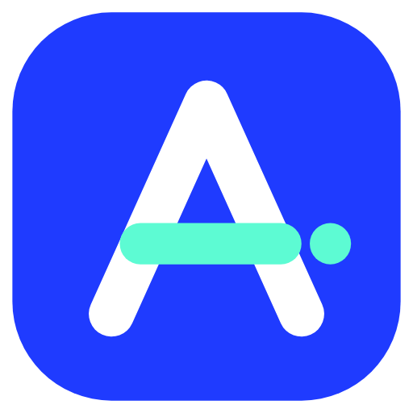
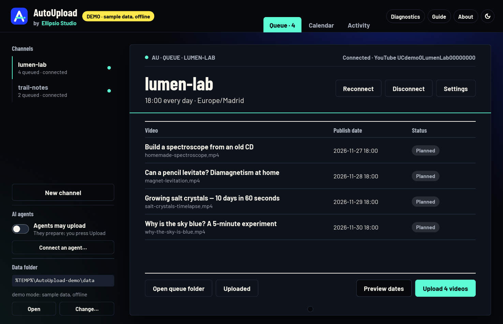
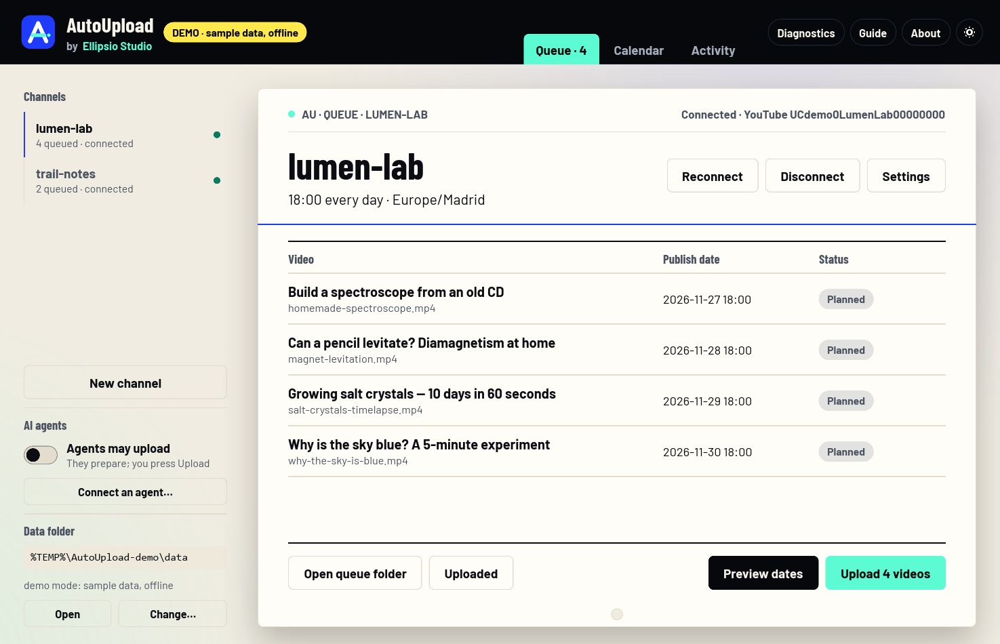
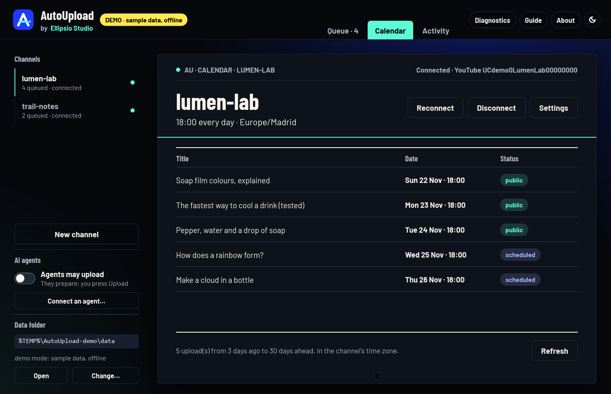
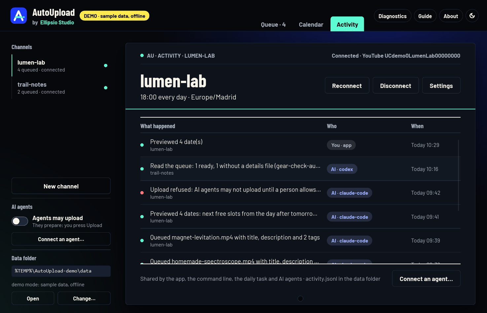

<p align="center"></p>

<h1 align="center">AutoUpload</h1>

<p align="center"><b>Automate your YouTube uploads from your own computer.</b><br>
A native app and command line written in Rust, that AI agents can drive. No server, no account, your own quota.</p>

<p align="center">
<a href="https://github.com/DaoSource111/autoupload/releases/latest"></a>


<a href="LICENSE"></a>
</p>

<p align="center"><b>English</b> · <a href="README.es.md">Español</a> · <a href="https://daosource111.github.io/autoupload/">Website</a> · <a href="https://daosource111.github.io/autoupload/install.html">Install guide</a> · <a href="https://daosource111.github.io/autoupload/agents.html">AI agents</a></p>

<p align="center"></p>

> **About the screenshots:** every screenshot in this repository and on the website was taken in demo mode. The channels, videos, titles, dates and activity shown are test data; they do not belong to any real YouTube channel or account.

Drop finished videos in a channel's queue folder, each with a small YAML file holding its title and details.
AutoUpload uploads them as **private** videos and gives each one the channel's **next free publishing slot**, so
YouTube publishes them on schedule. Or tell an AI agent "queue everything in my exports folder with good titles and
tags", and watch what it did in the app.

## Why AutoUpload

| | |
|---|---|
| **Native, written in Rust** | One small program per system (the command line is about 9 MB, the desktop app about 24 MB). No Python, no Node, no Electron or browser engine inside, nothing else to install: download, unzip, run. |
| **Local-first** | There is no AutoUpload server or account. Your videos, sign-in and history stay on your computer and talk only to Google, through *your own* OAuth client and quota. |
| **Built for AI agents** | `autoupload mcp` is a [Model Context Protocol](https://modelcontextprotocol.io) server: Claude Code, Codex, Cursor and other agents get typed tools to queue videos, write their details and preview dates. Uploading needs your permission, and everything an agent does appears in the app. |
| **Safe by default** | Nothing is uploaded without a confirmation (`--yes` or the Upload button). Nothing goes public at once unless you allow it, and never by an agent. It refuses to upload if the signed-in account is not the channel's. The same file is never uploaded twice. |
| **Made for unattended runs** | Uploads resume after a crash or a reboot from the last byte Google received. Short limits are retried; a spent daily quota stops cleanly. A daily task (Task Scheduler, launchd or systemd) empties every queue while you sleep. |

## Try it in ten seconds, without Google

```powershell
autoupload-gui --demo        # the desktop app with sample channels and an offline YouTube
autoupload --demo queue lumen-lab
```

Demo mode uses its own folder in your temp directory and never contacts Google, so you can press every button
(Upload included) safely. The screenshots on this page were taken with it.

## Download

Get the file for your system from the [latest release](https://github.com/DaoSource111/autoupload/releases/latest).
Each one holds the desktop app (`autoupload-gui`) and the command line (`autoupload`):

| System | File | First start |
|---|---|---|
| Windows 10/11 (x64) | `AutoUpload-<version>-windows-x64.zip` | unzip and open `autoupload-gui.exe`; if SmartScreen warns, choose *More info → Run anyway* |
| macOS 11+ (Apple silicon) | `AutoUpload-<version>-macos-arm64.zip` | move `AutoUpload.app` to Applications, then right-click it → *Open* the first time |
| macOS 11+ (Intel) | `AutoUpload-<version>-macos-x64.zip` | same as above |
| Linux (x64, glibc 2.35+) | `AutoUpload-<version>-linux-x64.tar.gz` | extract and run `./install.sh` (adds it to your applications menu) or `./autoupload-gui` |

The builds are not code-signed yet, hence the warnings. Verify a download with `SHA256SUMS` or
`gh attestation verify <file> --repo DaoSource111/autoupload`.

## Before the first upload

Each user creates their own OAuth client of type **Desktop app** in Google Cloud, enables the YouTube Data API v3 and
saves the client file as `config/client_secret.json` inside the data folder. The
[installation guide](https://daosource111.github.io/autoupload/install.html) walks through it step by step (or hands
it to an AI agent). The app's **Diagnostics** button, or `autoupload doctor`, says exactly what is missing.

AutoUpload asks Google for three scopes only: `youtube.upload`, `youtube.force-ssl` and `youtube.readonly`; the
[website](https://daosource111.github.io/autoupload/#permissions) explains what each one is used for.

## Desktop app

<p align="center"> </p>

Create a channel, press **Connect** to sign in with Google, put videos in the channel's queue folder and press
**Preview dates**. **Upload** asks for confirmation, then shows live progress. **Calendar** lists what is already
published and scheduled on YouTube. **Activity** shows what you, the daily task and AI agents did. Light and dark
follow the website's look; the sun/moon button switches them.

## Automate it with an AI agent

<p align="center"></p>

Register AutoUpload once in your agent (the app's **Connect an agent…** button shows these lines with the right path
for your computer):

```powershell
claude mcp add autoupload -- autoupload mcp                  # Claude Code
```

```toml
# Codex CLI: ~/.codex/config.toml
[mcp_servers.autoupload]
command = "autoupload"
args = ["mcp"]
```

Any other MCP client: a stdio server with command `autoupload` and argument `mcp`. Then ask in plain words, e.g.
*"Queue every video in D:\Exports for lumen-lab with a title, a description and tags, then preview the dates."*

| Tool | What it does | Needs your permission |
|---|---|---|
| `status` | data folder, channels, sign-in, queue sizes, what agents may do | |
| `list_queue` | the videos in a queue and what blocks each one | |
| `add_video` | copies (or moves) a video into a queue and writes its details file | |
| `write_sheet` | writes or replaces the details of a queued video | |
| `plan` | the date each queued video would get; uploads nothing | |
| `upload` | uploads the queue as private, scheduled videos | yes: **Agents may upload** in the app, or `autoupload agents allow-upload on` |
| `calendar` | published and scheduled uploads of a channel | |
| `doctor`, `activity` | setup checks; recent actions | |

Agents can never publish a video as public at once. Every call is written to `activity.jsonl` in the data folder,
with the agent's name, and the app's Activity tab picks it up within two seconds. An agent without MCP can use the
terminal instead: set `AUTOUPLOAD_AGENT=<its name>` and add `--json` to any command; the same rules apply.
The full guide, with example prompts, is at https://daosource111.github.io/autoupload/agents.html and in
[AGENTS.md](AGENTS.md).

## Command line

```powershell
autoupload doctor                              # check the setup and show the data folder
autoupload channel new mychannel               # create a channel
autoupload auth mychannel login                # sign in with Google (whoami, logout)
autoupload add mychannel clip.mp4 --title "My video" --tags a,b   # queue a video with its details
autoupload queue mychannel                     # what is queued and what blocks it
autoupload schedule mychannel                  # preview the dates: uploads nothing
autoupload schedule mychannel --yes            # upload
autoupload calendar mychannel                  # published and scheduled videos
autoupload activity                            # who did what, most recent last
autoupload task install --time 10:00           # upload every queue daily (task remove, task status)
autoupload agents setup                        # connect an AI agent
autoupload data-folder D:\Videos\AutoUpload    # keep channels and config somewhere else
```

`--json` prints machine-readable output; `--demo` works with every command. Exit codes: `0` OK, `2` invalid input or
setup, `3` authentication, `4` YouTube error.

## Daily run

`autoupload task install --time 10:00` registers a daily run with the system's own scheduler: Task Scheduler on
Windows, launchd on macOS, a systemd user timer on Linux (with a `crontab` line as fallback). It runs
`autoupload task run`, which uploads every channel's queue, writes a log to `logs/` in the data folder (kept 60 days)
and records the result in the Activity tab. `autoupload task remove` takes it away.

## Channel settings (`channels/<channel>/channel.yaml`)

| Key | Default | Meaning |
|---|---|---|
| `profile` | channel name | name of the OAuth token |
| `client_secret` | `../../config/client_secret.json` | Desktop OAuth client file |
| `timezone` | `"+00:00"` | zone of `hours`: a name that follows daylight saving (`Europe/Madrid`, `America/Lima`) or a fixed UTC offset (`+00:00`, `-05:00`) |
| `hours` | `["08:00"]` | publishing times for each day |
| `days_between` | `1` | 1 = every day, 7 = once a week |
| `min_lead_hours` | `3` | never schedule closer than this to now |
| `max_per_run` | `5` | uploads per run |
| `language` | `en` | language of title, description and audio |
| `category` | `"27"` | YouTube category ID (27 Education, 28 Science & Technology, 24 Entertainment) |
| `made_for_kids` | `false` | "made for kids" declaration |
| `contains_ai` | `null` | altered or synthetic content declaration |
| `notify_subscribers` | `false` | notify subscribers on publication |
| `playlist` | `null` | playlist ID for every upload |
| `base_tags` | `[]` | tags added to every video |
| `description_footer` | `""` | text appended to every description |

Unknown keys are rejected, so a typo is reported instead of silently ignored.

## Video details (`<video>.yaml` next to each video)

```yaml
title: Why is the sky blue? A 5-minute experiment     # the only required key
description: |
  Rayleigh scattering with a glass of water and a torch.
tags: [physics, light, experiment]
publish_at: 2026-12-01T18:00:00+01:00   # optional fixed date; otherwise the next free slot
```

Other keys: `thumbnail` (or an image with the same name next to the video), `playlist_id`, `privacy`, `category_id`,
`default_language`, `default_audio_language`, `made_for_kids`, `contains_synthetic_media`, `notify_subscribers`,
`captions`, `localizations`.

## Where your data lives

- **Data folder** (`channels/`, `config/`, `activity.jsonl`, `logs/`), chosen in this order: `AUTOUPLOAD_HOME`; the
  folder set with `autoupload data-folder` or the app's **Change…** button; a `channels/` or `config/` folder next to
  the program (portable copy); otherwise `Documents\AutoUpload` (`~/AutoUpload` on macOS and Linux).
- **Sign-in tokens and settings**: `%APPDATA%\AutoUpload` on Windows, `~/.config/autoupload` on macOS and Linux
  (override with `AUTOUPLOAD_CONFIG_DIR`); readable only by your user on macOS and Linux.
- `config/client_secret.json`, tokens and channel data must never be shared or committed; `.gitignore` excludes them.
- Files from AutoUpload 1.x (tokens, `channel.yaml`, video files, `state.sqlite`) are read unchanged.

## Build from source

Requires Rust 1.80+ (on Linux also `libfontconfig1-dev libxkbcommon-dev`):

```powershell
cargo test --workspace
cargo build --release          # target/release/autoupload and autoupload-gui
cargo run -p autoupload-gui -- --demo
```

## Repository layout

| Path | Contents |
|---|---|
| `crates/core/` | the engine: channels, queue, OAuth, YouTube client and resumable upload, state, activity log, agent operations, daily task, demo |
| `crates/cli/` | the `autoupload` command line and its MCP server (`src/mcp.rs`) |
| `crates/gui/` | the desktop app (Slint, with the website's fonts and colours) |
| `tools/site/` | the website generator (`cargo run -p autoupload-site`) |
| `docs/` | the public website on GitHub Pages; edit `docs/_src/{en,es}/` |
| `packaging/` | Linux menu entry and installer, macOS bundle metadata |
| `assets/` | logo, social preview and screenshots (taken in demo mode) |

The whole project is Rust, apart from the website's HTML and CSS, the GitHub workflows and a short Linux
install script. AutoUpload 1.x was written in Python; it remains available as
[release 1.2.0](https://github.com/DaoSource111/autoupload/releases/tag/v1.2.0).

## License

MIT © 2026 Ellipsio Studio. AutoUpload is not affiliated with, endorsed or sponsored by Google LLC or YouTube.
Support: ellipsio.studio@gmail.com
